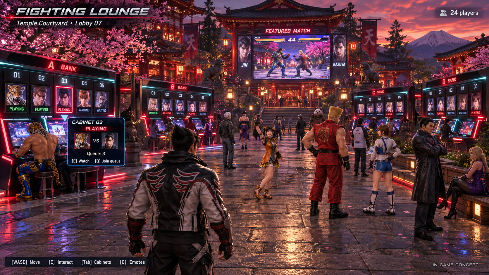
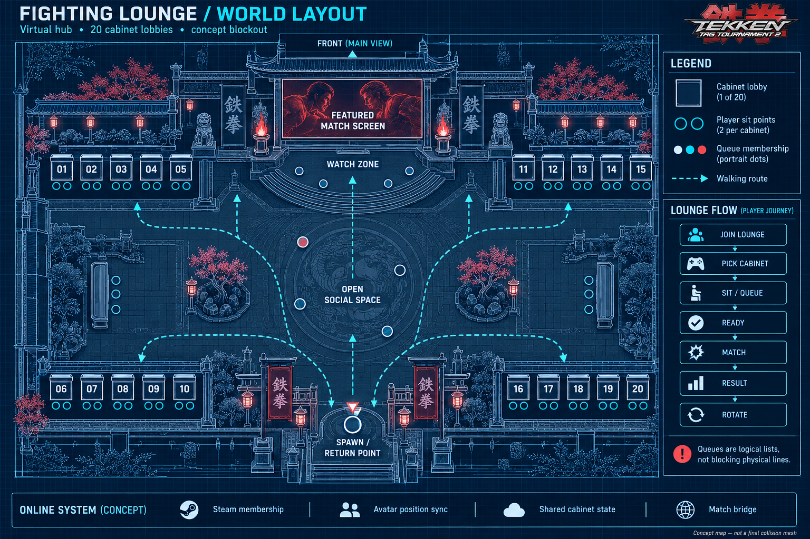

# TTT2 Fighting Lounge (work in progress)

ONLINE MODE -> FIGHTING LOUNGE. Beta 0.0.1 is the first layer of a larger plan: a 3D lounge like TEKKEN 8's
Fighting Lounge, where players walk around as TTT2's own characters, emote, sit on benches to watch, and sit down
at arcade cabinets to fight.

## Concept art

A temple courtyard at dusk with four banks of five cabinets (01-20), a featured-match screen, benches for
spectators, and the players as TTT2 characters.

## Beta 0.0.1 (now)

Code: `port/src/runtime/kernel/lounge.h`, `lounge.cpp`; the menu row and page in `menu_doc.cpp`.

- A lounge per network: the first game in hosts it, the others join; up to 32 players.
- LOUNGE CHAT: a text chat for everyone in the lounge (80 characters a message).
- 20 cabinets 01-20 as rows of a menu page: sit, ready, leave, a queue per cabinet.
- Both seated players ready: their games walk the online menus to PLAYER MATCH -> QUICK MATCH (unranked), and the search is pinned to
  the cabinet opponent (`ranked::PlanLoungeMatch`). Winner stays, the next in line takes the loser's seat.

Known limits and open items:

- The cabinet match itself (the pinned ranked search, the winner report, rotation) is not tested yet: it needs two
  PCs on Steam.
- The lounge closes when its host leaves.

## Plan

1. Menu lounge (0.0.1): cabinets, queues, chat, the match flow.
2. 3D room: one stage as the lounge, TTT2 character models as avatars, walking, a third-person camera, positions
   shared over Steam. The same cabinet and queue state as the menu page.
3. Emotes and sitting: an emote wheel, seats at cabinets and on benches, a sitting pose (TTT2 has none).
4. Spectating: watching a cabinet's match live.
5. Presentation: the featured-match screen, cabinet previews.
