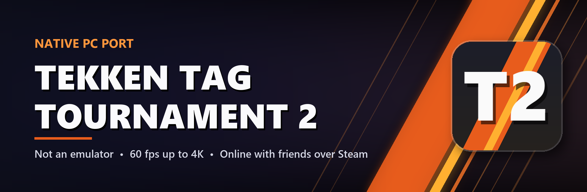
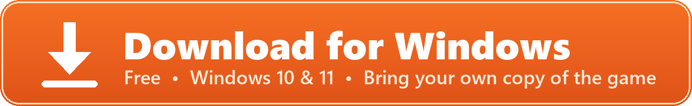
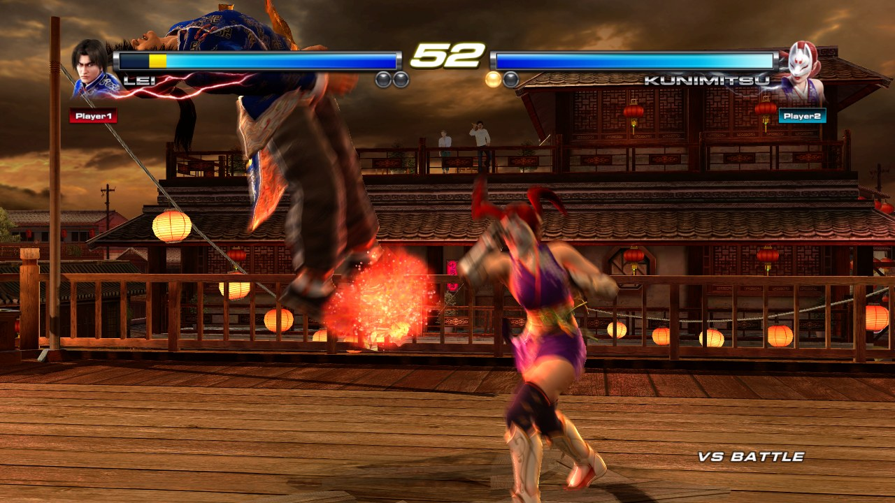
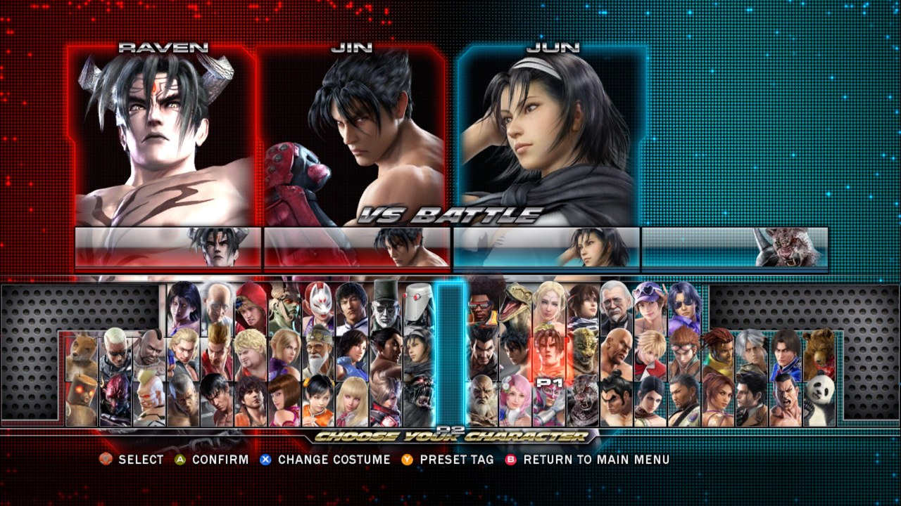
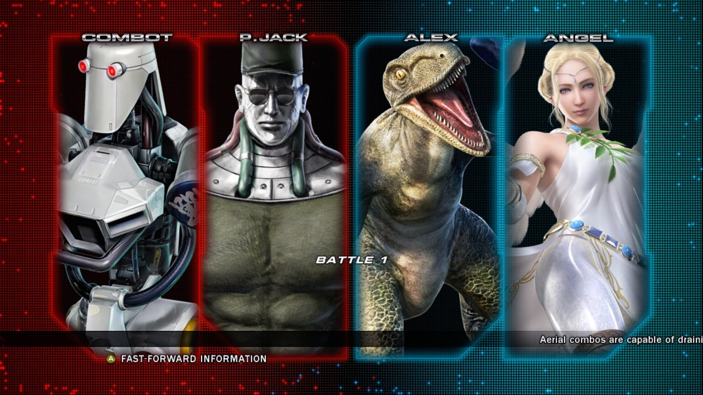
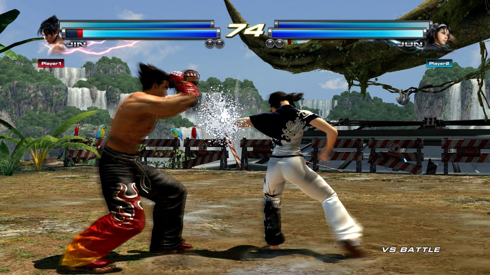
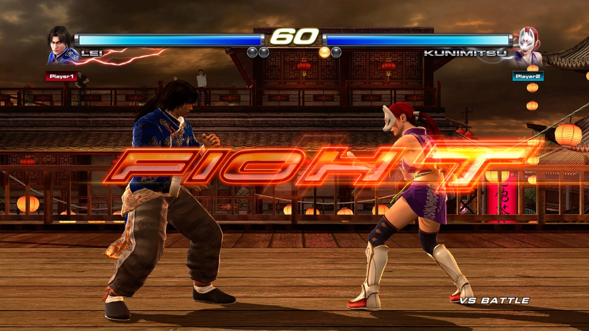
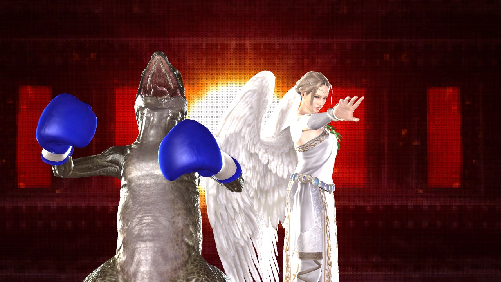
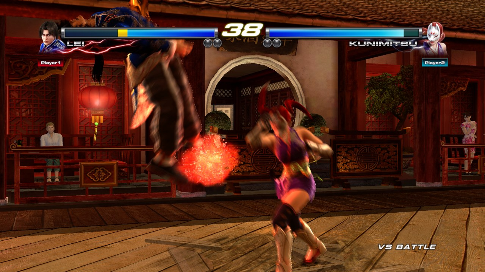

  

  
  
  
  

  

  <a href="#install"><b>Install</b></a> &nbsp;•&nbsp;
  <a href="#whats-new-in-023"><b>What's new</b></a> &nbsp;•&nbsp;
  <a href="#all-patch-notes"><b>Patch notes</b></a> &nbsp;•&nbsp;
  <a href="https://github.com/thatcalikid760/TTT2-Recomp/issues/new?template=bug_report.yml"><b>Report a bug</b></a> &nbsp;•&nbsp;
  <a href="BUILDING.md"><b>Build from source</b></a>

**TTT2 Recomp** by ThatCaliKid760 is a patched build of the native PC static recompilation of *Tekken Tag Tournament 2* (Xbox 360), with fixes and quality-of-life improvements for online play. It's not an emulator: the game's own code runs natively on your PC.

  

<table>
  <tr>
    <td></td>
    <td></td>
    <td></td>
  </tr>
  <tr>
    <td></td>
    <td></td>
    <td></td>
  </tr>
</table>

## Features

| | |
|---|---|
| 🌐 **Online play** | Ranked and Player Match over Steam, rollback netcode, community servers with leaderboards, teams and replays, ranked rematch, rage-quit penalties |
| 🎮 **Every controller** | Xbox, DualShock 4, DualSense and keyboard, with button prompts that follow the controller you use |
| 🖥️ **PC graphics** | Up to 4K at 60 fps, windowed / borderless / fullscreen, FSR 1, SMAA / FXAA, presets, V-Sync, render scale |
| 🎙️ **Voice and text chat** | Open mic or push-to-talk, per-player mute, text chat in lobbies |
| 🕹️ **Classic Offline** | An arcade-style mode where you unlock 37 fighters one ARCADE clear at a time |
| 🔄 **Built-in updates** | The game tells you when a new version is out and installs it for you |

> Steam must be running in the background for online play.

## Install

1. Download **[ttt2_setup.exe](https://github.com/thatcalikid760/TTT2-Recomp/releases/latest/download/ttt2_setup.exe)** (or pick a version on the [Releases](https://github.com/thatcalikid760/TTT2-Recomp/releases) page).
2. Point it at your own *Tekken Tag Tournament 2 (USA, Europe)* Xbox 360 disc image and Title Update 3.
3. Launch the game from your Desktop or Start menu.

> [!IMPORTANT]
> **You need your own copy of the game.** This project contains no game files; the installer builds them on your PC from your disc image.

## What's new in 0.2.5

- **Fighting Lounge (beta, work in progress):** ONLINE MODE > **FIGHTING LOUNGE**. A shared lounge with **LOUNGE CHAT** for everyone in it and 20 cabinets (01-20). Xbox **A** (PlayStation **Cross**, keyboard **A**) sits down, joins a full cabinet's queue, or readies up; Xbox **X** (PlayStation **Square**, keyboard **Z**) leaves. When both seated players are ready, the game takes them to an unranked Player Match against each other; the winner stays and the next in line takes the other seat. The cabinet match itself is still being tested: please report what happens. Everyone needs 0.2.5. The 3D lounge with your fighters as avatars is in the works (see `FIGHTING_LOUNGE.md`).
- **VS BATTLE with an Xbox and a PlayStation controller:** a PlayStation pad that becomes player 2 now counts, so VS BATTLE is no longer grayed out.
- **Keyboard as its own player:** Options > Game Options > **KEYBOARD PLAYER**. PLAYER 1 (default) adds the keys to player 1's controller as before; SEPARATE makes the keyboard a player of its own, so a keyboard and one controller can play VS BATTLE.
- **Fixed: online matches stuck on "syncing"** (0.2.4 was pulled for this). The ONLINE CROWDS option is gone: on most stages it crashed the game while the match loaded, leaving both players waiting.
- **GAME CHAT** takes up to 80 characters; longer messages go out as several.

## All patch notes

<b>0.2.3</b>

- **Ranked rematch:** after a ranked match both players are asked **REMATCH?**: yes with Xbox **Y** (PlayStation **Triangle**, keyboard **X**) or a left-click on the note, no with Xbox **X** (PlayStation **Square**, keyboard **Z**) or a right-click. If both say yes you play the same opponent once more, as in TEKKEN 8.
- **Rage-quit penalties** (community servers): leaving a ranked match early counts as a loss, earns a strike and locks you out of ranked matchmaking for 5 minutes (15 for the second strike, an hour from the third; a strike is forgiven every 24 hours). The opponent's quit rate shows when a ranked match is found.
- **Classic Offline:** on the main menu, put the cursor on OFFLINE MODE and press Xbox **X** (PlayStation **Square**, keyboard **Z**). You start with 22 fighters; every ARCADE clear unlocks the next one. Progress is kept per profile, and the option disappears once all 37 are unlocked. The normal Offline Mode keeps the full roster.
- The player card shows your **Steam avatar** (it was see-through).
- The ONLINE MODE menu notes that Steam must be running for online play.
- Select Profile shows **RENAME** (Xbox **Y**, PlayStation **Triangle**, keyboard **X**) and **DELETE** (Xbox **X**, PlayStation **Square**, keyboard **Z**) in the bottom bar; the icons follow the controller you use.
- Keyboard keys are the defaults; with your own in Controller Setup, use the keys you set for Y and X.
- Rematch and quit reports need 0.2.3 on both sides; server owners need the new `ttt2-server` for the penalties.

<b>0.2.2</b>

- **Delete profiles:** on Select Profile, press Xbox **X** (PlayStation **Square**, keyboard **Z**) on a profile and confirm. Its save data goes to the Recycle Bin, so it can be restored.
- Display Settings no longer shows 3D MODE / 3D DEPTH.
- **Motion blur** has one switch again: the game's own in Display Settings (the copy in Graphics Settings is gone).
- The online menu no longer shows "SEARCH FOR Xbox LIVE PARTY" (it did nothing).

<b>0.2.1</b>

- **Ranked Match** works on Steam again (0.2.0 grayed it out unless a community server was picked). Team and Leaderboards still need a server.

<b>0.2.0</b>

- **From upstream 0.1.7:** rollback netcode (Options > Game Options > ONLINE NETCODE), community servers with Ranked Match, leaderboards, teams, Tekken Channel replays and ghosts, Steam Friend Invite (Y in a Player Match room), pair play online, rooms no longer vanishing after a few matches, shaders prepared by the installer (no first-time stutter), texture mipmaps, laptops on the dedicated GPU, and 640x360 / 960x540 resolutions.
- **Graphics Settings:** presets (LOW to ULTRA), FSR 1 upscaling with FSR modes, SMAA anti-aliasing, motion blur and shadows on/off. The page scrolls.
- **Fix:** the voice chat panel's player list no longer reshuffles, so mute hits the player you picked.

<b>0.1.9</b>

- **Update notifications:** when you pick your profile, the game checks for a newer version and shows your build number in the top right. If an update is out, click the notification to download it, then click again to install (right-click dismisses it).
- **Voice chat in the lobby:** press the right stick: Xbox **RS**, PlayStation **R3** (keyboard **F7**) in the menus or an online lobby to change voice mode and volume and to mute players without leaving the lobby. The lobby's button bar shows the shortcut for your controller.
- **Steam profiles:** in that panel, select a player and press Xbox **X** (PlayStation **Square**, keyboard **Z**) to open their Steam profile.
- The mouse cursor hides when you're not using the mouse.
- **Fix:** with FXAA or sharpening on, the picture could be cut off at large render scales.

<b>0.1.8</b>

- **Graphics Settings:** V-Sync, render scale (supersampling), FXAA, anisotropic filtering, sharpening, brightness, FPS counter.
- **Voice Chat:** open mic or push-to-talk in online lobbies and matches, voice volume, mute players (F8 mutes everyone).
- **Updates:** check for and install new versions from inside the game (Options > Updates).
- **Fix:** Discord Join now works for friends-only sessions.

<b>0.1.7 (+ hotfix)</b>

- **PS4 / PS5 controllers:** native DualShock 4 and DualSense support.
- **Button prompts** switch between PlayStation, Xbox and keyboard icons across all menus and in-game UI (menu setting).
- **Discord Join:** join a friend's open lobby straight from Discord, no lobby search needed.
- **Text chat** in online custom lobbies, for players without a microphone.
- **Installer update mode:** updates an existing install and keeps your progress.
- **Fix:** custom character portraits no longer show as a black box.

## Reporting bugs

Found a crash, a graphics glitch or something online that doesn't work?

(Needs a free GitHub account.)

Please include:
- your version (shown in the top right when you pick your profile),
- what happened and how to make it happen again,
- your log file: press Win+R, type `%LOCALAPPDATA%\TTT2Recomp` and attach `log.txt`. It's replaced every time the game starts, so grab it before launching again.

## Credits

This project is built on **[shihabal3amri/tekken-tag-tournament-2-pc](https://github.com/shihabal3amri/tekken-tag-tournament-2-pc)**, the original native Windows port by static recompilation. All credit for the port itself goes to that project and the tools it builds on ([XenonRecomp](https://github.com/hedge-dev/XenonRecomp), with [Unleashed Recompiled](https://github.com/hedge-dev/UnleashedRecomp) and [Xenia](https://github.com/xenia-project/xenia) as references).

## Legal

Unofficial fan project, not affiliated with or endorsed by Bandai Namco or Microsoft. Tekken and all related characters and content are the property of their respective owners.
